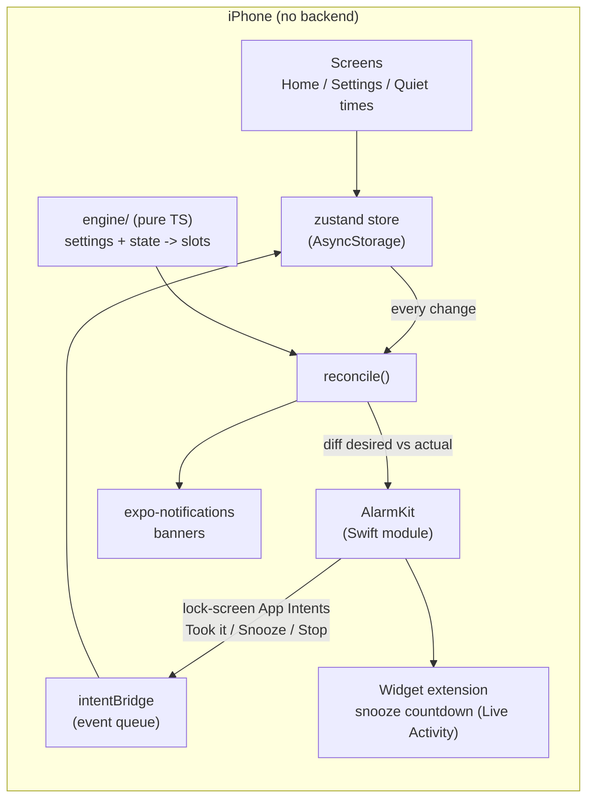

# Take My Pill

A nightly pill reminder that keeps ringing until you tap "Took it". I built it for my partner, who kept missing her evening pill because a normal reminder is one buzz that is easy to swipe away.

It has had two lives. Version 1 was a Hebrew PWA with web push, served from Netlify. It worked, but iOS web push is a quiet banner that cannot ring through silent mode, so pills still got missed. Version 2 is a native iOS app (Expo + a custom Swift AlarmKit module) that rings real alarms, the same tier as the Clock app, and cancels every remaining alarm the moment she taps "Took it". It is on her phone through TestFlight (build 9 at the time of writing), and both generations live in this repo.

Built with Claude Code as my pair: I designed the product, the scheduling model and the architecture, and directed the implementation.



## How it works

### Native app (`app/`)
- **Engine (`src/engine/`)**: a pure TypeScript function turns settings + state into the list of "slots" for tonight and tomorrow. Banners every hour from the reminder start (default 18:00) until the alarm start (default 21:00), then a real alarm every hour with a banner 30 minutes after each, all stopping at a hard 04:00 end of night. Taken nights, pauses and quiet times are filtered out. No side effects, so it is unit tested directly.
- **Deterministic ids (`engine/ids.ts`)**: every slot id is a UUID derived from (kind, fire minute). Re-running the engine always produces the same ids, which is what makes the next step safe.
- **Reconcile (`src/services/reconcile.ts`)**: the only code that touches the phone. It diffs the desired slots against what iOS has scheduled, cancels extras and schedules what is missing. It is idempotent and serialized, so it runs on every state change without care. Tapping "Took it" just marks the night as taken, and reconcile cancels the rest.
- **AlarmKit bridge (`modules/pill-alarm/` + `native/ios/PillAlarmCore.swift`)**: a thin Expo module for schedule / cancel / list / authorization, plus the Swift App Intents behind the lock-screen buttons. Intents run while JS may be asleep, so they leave events in UserDefaults that the app drains on launch, on foreground and on a short poll (`intentBridge.ts`).
- **Snooze (`targets/snooze/`)**: uses AlarmKit's own snooze. The same alarm counts down as a Live Activity (lock screen, Dynamic Island, StandBy), then rings again identically. A widget extension draws the countdown; shared Swift in `_shared/` compiles into both the app and the widget.
- **Banners (`src/services/banners.ts`)**: quiet reminders between alarms, with escalating copy through the night (`i18n/funny.ts`: gentle, then cheeky, then full nagging).
- **UI**: one big hero button, tonight's timeline, settings for times, sound and snooze length, and quiet times for nights out. Hebrew (feminine forms) and English, with direction handled manually per component instead of a global RTL reload. Custom Skia confetti on "Took it".
- **Tester mode**: a hidden screen that compresses the whole night into a one-hour schedule (an alarm or a banner every minute), so alarms can be tested end to end on a real device in minutes instead of a full evening.
- **Design review page (`review/generate.mjs`)**: renders every screen in English and Hebrew at true device scale, from the real string files and theme tokens, with a notes box per screen. I review design changes there before they go into the app.

### Legacy PWA (repo root)
- `index.html` + `sw.js` + `manifest.json`: an installable RTL Hebrew PWA. The service worker caches the shell and shows push notifications.
- `netlify/functions/`: `subscribe` stores the push subscription in Netlify Blobs (keyed by a SHA-256 of the endpoint), `taken` / `taken-reset` mark the night as done, `clocks` saves which of the 17 time slots are on, and `notify` is hit by an external cron with a shared secret. On a matching slot it sends a web push (VAPID) to every subscription that has not taken the pill, and deletes expired subscriptions (410/404).

## Tech stack
- Native: Expo SDK 54, React Native 0.81 (new architecture), TypeScript, Swift (AlarmKit, App Intents, WidgetKit / ActivityKit), expo-notifications, expo-audio, zustand + AsyncStorage, React Navigation, react-native-skia, Reanimated, Jest
- Build and delivery: EAS Build (cloud, no Mac), TestFlight, EAS Update (OTA), Expo config plugins, `@bacons/apple-targets` for the widget extension
- PWA: vanilla HTML/JS, Service Worker, Web Push (VAPID, `web-push`), Netlify Functions, Netlify Blobs
- Tooling: ffmpeg for sound mastering, Node for icon rendering and the review page

## Engineering decisions and tradeoffs
- **Native rewrite instead of more PWA work.** iOS web push cannot bypass silent mode or Focus, and a reminder you can sleep through does not solve the problem. AlarmKit (iOS 26+) can. Cost: iOS 26.1+ only and a native build pipeline. Research notes: [`docs/native-alarm-research.md`](docs/native-alarm-research.md).
- **All scheduling on the phone, no backend.** The PWA depended on a cron, a server and a push service, and any of them could fail silently. The native app schedules alarms with the OS, so they fire even if the app is force-quit and the phone is offline.
- **Engine + reconcile instead of imperative scheduling.** Rather than "schedule 7 alarms, remember to cancel them", the app always computes the full desired state and diffs it. Pausing, quiet times, language changes and "Took it" all become one code path, and it cannot duplicate alarms.
- **AlarmKit's built-in snooze over a custom one.** Build 8 had my own snooze intent that created a fresh alarm 10 minutes later, with nothing visible in between. Build 9 uses `.countdown` + a Live Activity, so the user sees the countdown, and it behaves like Apple's own alarms.
- **OTA for everything JS, native builds only when needed.** EAS Update ships UI and logic changes to the installed TestFlight build. `runtimeVersion` is bumped only on native changes, and `capabilities.ts` gates features by runtime version, because OTA bundles also reach older native builds that lack the new Swift code.
- **TestFlight, not the App Store.** There is one user. TestFlight internal testing avoids review overhead; the tradeoff is uploading a fresh build every ~75-80 days before the 90-day expiry.
- **Rejected:** `expo-alarm-module` / Android's `ACTION_SET_ALARM` (alarms cannot be cancelled programmatically, which breaks "Took it cancels everything"), and Critical Alerts (Apple-gated entitlement, not needed once AlarmKit exists).

## Problems hit and how I solved them
- **The "AlarmKit entitlement" that does not exist.** Many blog posts say AlarmKit needs a special Apple entitlement. It does not, an Apple engineer confirmed it on the developer forums, and adding it breaks provisioning. Only an Info.plist usage string and a runtime permission are needed. Lesson: verify AI-generated and SEO claims against primary sources before designing around them.
- **App Intents silently ignored.** Expo local modules compile as CocoaPods static frameworks, where Xcode never discovers App Intents, so the lock-screen buttons did nothing. Fix: keep the pod as a thin bridge and inject the real Swift into the main app target with a config plugin (`plugins/withPillAlarmNative.js`).
- **No Mac.** I develop on Windows, where Expo prebuild for iOS does not run. EAS builds in the cloud, and the TestFlight build is the Swift compile check, so native changes are batched carefully.
- **The newest EAS image crashed the app.** The `latest` image ships Xcode 27, whose SDK crashes apps without the UIScene lifecycle on iOS 27 (Expo SDK 54 apps). `eas.json` pins an Xcode 26.x image.
- **"The alarm is too quiet."** Real user feedback. Measured, the sound file itself peaked at -9.5 dB and averaged -25 dB, while normal alarm tones sit near 0 dB peak. I remastered it to about -15 dB average and -0.8 dB peak with gentle compression and a limiter. Recording in 32-bit float instead of 16-bit removed the clipping crunch. AlarmKit does not loop custom sounds, so the pattern is baked into a 90-second file.
- **Test alarms take 2-3 seconds to appear.** iOS has no documented "ring now". The UI shows a small "ringing in a moment" state instead of looking broken.
- **Hebrew RTL without app reloads.** React Native's global RTL switch needs a restart. Direction is handled per component with a `useDir()` hook, and the native layout mirroring is turned off.
- **PWA timezone shortcut.** `taken.mts` approximates "next 18:00 Israel time" with a fixed UTC hour. Close enough for one user, and one of the reasons the logic moved onto the phone.

## Running it locally

### Native app
Requires an Apple developer account, an Expo account and an iPhone on iOS 26.1+. Expo Go cannot run it (custom native code).
```bash
cd app
npm install
cp .env.example .env      # fill in your own ids
npm test                  # engine + snooze + copy tests (Jest)
npm run typecheck
npx eas build -p ios --profile testflight   # or a dev client build
npm run update -- --message "..."           # OTA to the preview channel
```
Env vars (`app/.env.example`): `EXPO_PROJECT_ID`, `EXPO_OWNER`, `IOS_BUNDLE_ID`, `APPLE_TEAM_ID`. Submit settings in `eas.json` are placeholders too.

**Alarm sounds.** The two custom alarm files (`assets/sounds/gentle.caf` and `tone.caf`) and the song preview are not in this repo: one is a private recording, and both are large. The app still builds without them (the config only bundles files that exist); choose Normal in Settings to use the iPhone's own alarm sound, or drop in your own files under those names. To make your own: `scripts/make-gentle-sound.sh` generates a soft tone with ffmpeg, and `scripts/sound/record-loopback.py` + `scripts/sound/master-alarm.sh` record and master any audio you have the rights to into a 90-second CAF.

Review page: `node --experimental-strip-types review/generate.mjs`, then `python -m http.server 4173` inside `app/review`.

### Legacy PWA
```bash
npm install
npx web-push generate-vapid-keys   # put the public key in index.html (VAPID_PUBLIC_KEY)
npx netlify dev
```
Env vars (`.env.example`): `VAPID_PUBLIC_KEY`, `VAPID_PRIVATE_KEY`, `VAPID_EMAIL`, `CRON_SECRET`. Point any cron at `/.netlify/functions/notify?secret=<CRON_SECRET>` every minute (it only sends on the 17 configured slots).

## Status and what's next
- Native iOS app: in use on her phone via TestFlight. The PWA is legacy and will be retired.
- Next: Android (the research points to AlarmManager `setAlarmClock()` + Notifee, with a boot receiver to restore alarms) and possibly an App Store release (which would also need properly licensed alarm audio).

## License
MIT, see [LICENSE](LICENSE).
